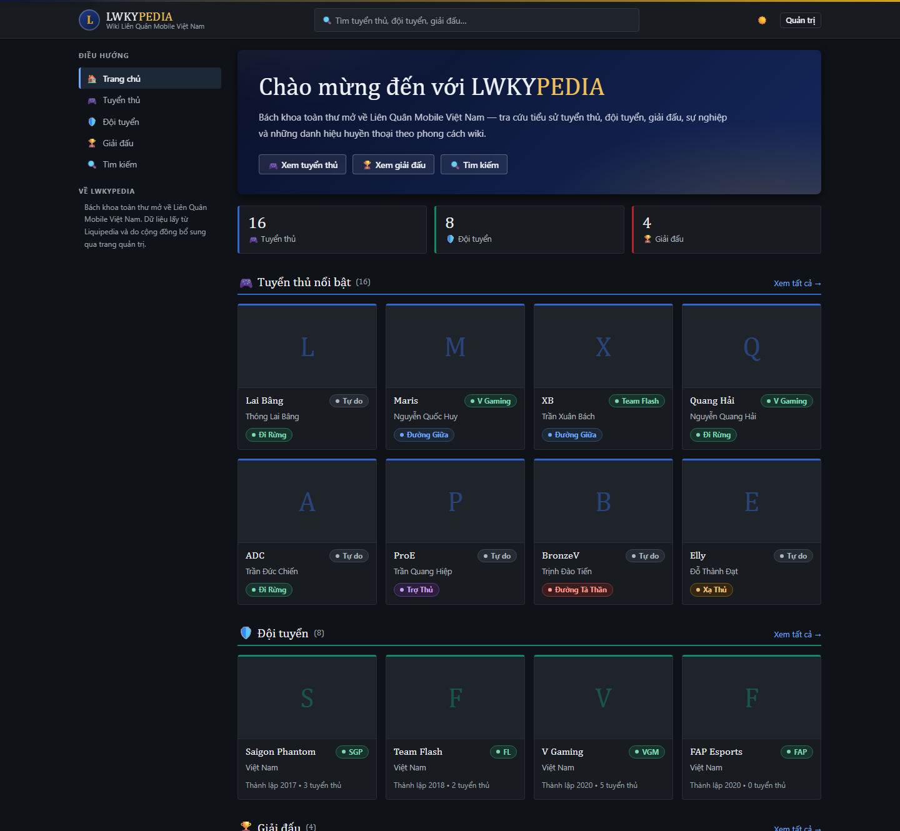
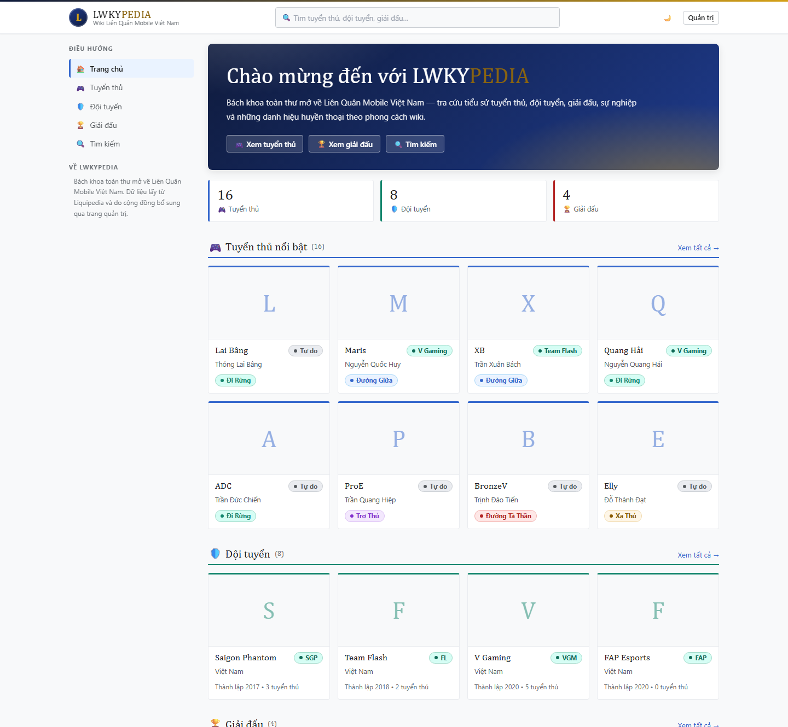
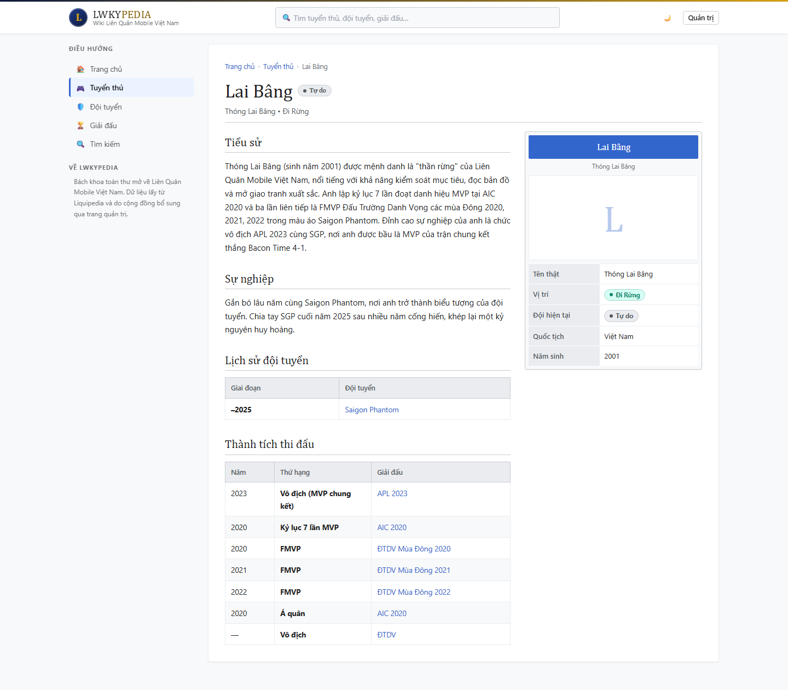
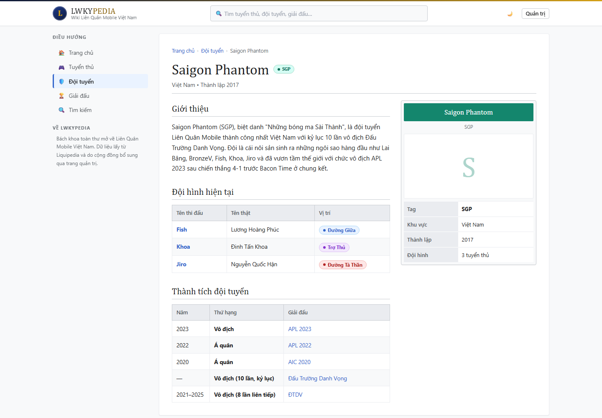
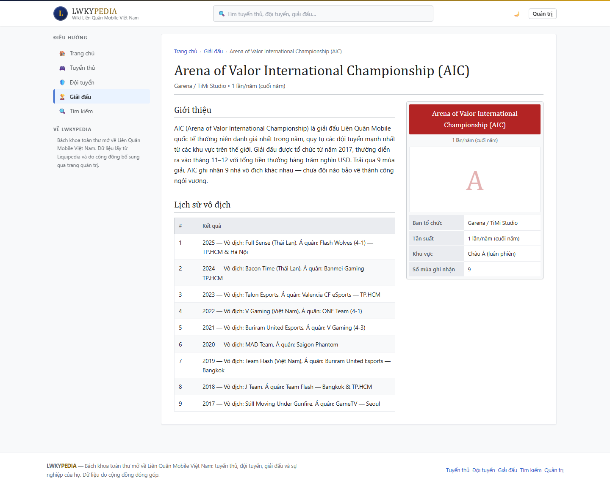
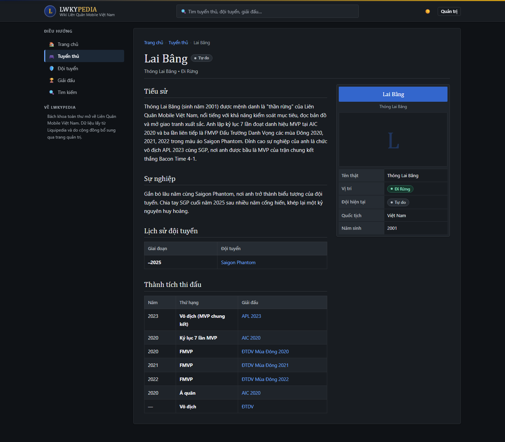
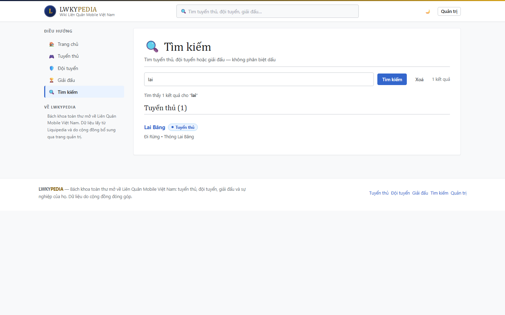

<div align="center">



# LWKYPEDIA

**Bách khoa toàn thư mở về Liên Quân Mobile (Arena of Valor) Việt Nam**

Tiểu sử tuyển thủ · Đội tuyển · Giải đấu · Sự nghiệp · Thành tích — theo phong cách wiki.

[](https://nextjs.org)
[](https://www.typescriptlang.org)
[](https://tailwindcss.com)
[](https://vercel.com)

**🔗 https://lwkypedia.vercel.app**

</div>

---

## Giới thiệu

Lwkypedia là một wiki tĩnh–động cho cộng đồng Liên Quân Mobile Việt Nam: tra cứu hồ sơ
tuyển thủ, đội tuyển và giải đấu với giao diện lấy cảm hứng từ **Wikipedia (Vector 2022)**
và **Liquipedia** — khung bài viết, infobox, bảng thành tích, chế độ tối/sáng.

Dữ liệu lưu trong **Vercel Blob** dưới dạng JSON và chỉnh sửa trực tiếp qua trang quản trị
có đăng nhập. Không có cơ sở dữ liệu, không có ORM — chỉ ba file JSON và một lớp đọc/ghi
có cache.

<table>
<tr>
<td width="50%"></td>
<td width="50%"></td>
</tr>
<tr>
<td align="center"><sub>Trang chủ — chế độ sáng</sub></td>
<td align="center"><sub>Hồ sơ tuyển thủ — infobox + bảng thành tích</sub></td>
</tr>
</table>

## Tính năng

**Giao diện công khai**

- 🏠 **Trang chủ** — hero, số liệu tổng quan, tuyển thủ nổi bật, đội tuyển, giải đấu, cập nhật gần đây.
- 🎮 **Tuyển thủ** — danh sách có lọc theo đội và vị trí; hồ sơ gồm tiểu sử, sự nghiệp,
  lịch sử đội tuyển và **bảng thành tích kiểu Liquipedia** (Năm · Thứ hạng · Giải đấu có liên kết).
- 🛡️ **Đội tuyển** — đội hình hiện tại (link tới từng tuyển thủ) và thành tích đội.
- 🏆 **Giải đấu** — ban tổ chức, tần suất, khu vực và lịch sử vô địch theo mùa;
  tên đội trùng với đội tuyển trong wiki tự động thành liên kết.
- 🔍 **Tìm kiếm** — không phân biệt dấu (`lai bang` khớp `Lai Bâng`), có gợi ý trực tiếp ở header.
- 🌗 **Chế độ tối/sáng** — lưu ở `localStorage`, chống nháy (FOUC) bằng script chạy trước khi vẽ.
- 📱 **Responsive** — sidebar điều hướng thu thành ngăn kéo trên mobile.

**Quản trị**

- 🔐 Đăng nhập bằng mật khẩu tại `/admin`; phiên ký HMAC có hạn, có giới hạn số lần thử.
- ✏️ CRUD đầy đủ cho cả ba loại thực thể, kèm editor bảng cho thành tích và lịch sử đội tuyển.
- 🔗 Liên kết chéo: chọn giải đấu/đội từ danh sách để tên tự động thành link.
- ♻️ Lưu xong là revalidate toàn site; đổi/xoá slug sẽ tự cập nhật mọi tham chiếu trong dữ liệu.

<table>
<tr>
<td width="50%"></td>
<td width="50%"></td>
</tr>
<tr>
<td align="center"><sub>Đội tuyển — đội hình + thành tích</sub></td>
<td align="center"><sub>Giải đấu — lịch sử vô địch</sub></td>
</tr>
<tr>
<td width="50%"></td>
<td width="50%"></td>
</tr>
<tr>
<td align="center"><sub>Cùng trang ở chế độ tối</sub></td>
<td align="center"><sub>Tìm kiếm không dấu</sub></td>
</tr>
</table>

## Kiến trúc

```
lowkeypedia/
├── app/                      # Next.js App Router
│   ├── layout.tsx            # metadata, theme script, chrome
│   ├── page.tsx              # trang chủ
│   ├── loading.tsx           # skeleton hiện khi chờ server render
│   ├── error.tsx             # lưới an toàn khi trang ném lỗi
│   ├── sitemap.ts            # sitemap động (trang tĩnh + mọi chi tiết)
│   ├── robots.ts             # robots.txt (chặn /admin, /api)
│   ├── tuyen-thu/            # danh sách + [slug] hồ sơ tuyển thủ
│   ├── doi-tuyen/            # danh sách + [slug] trang đội tuyển
│   ├── giai-dau/             # danh sách + [slug] trang giải đấu
│   ├── tim-kiem/             # trang kết quả tìm kiếm
│   ├── admin/                # đăng nhập + dashboard (Client Components)
│   └── api/                  # route handlers
│       ├── search/           #   gợi ý tìm kiếm
│       └── admin/            #   login · logout · CRUD 3 loại
├── components/               # 17 component trình bày
├── lib/
│   ├── store.ts              # đọc/ghi Blob, cache, chuẩn hoá, cascade
│   ├── auth.ts               # phiên quản trị (HMAC), verifyPassword
│   ├── ratelimit.ts          # giới hạn đăng nhập theo IP
│   ├── revalidate.ts         # revalidate toàn site sau khi ghi
│   ├── http.ts               # chuẩn hoá lỗi → HTTP response
│   ├── types.ts              # Player · Team · Tournament · Achievement
│   ├── entities.ts           # bảng ánh xạ loại thực thể → URL/nhãn
│   ├── params.ts             # ép searchParams về vô hướng, strip markdown
│   ├── slug.ts               # slugify + chuẩn hoá tìm kiếm không dấu
│   └── site.ts               # tên thương hiệu, URL gốc
├── data/seed/                # dữ liệu mẫu (tự seed lên Blob lần đầu)
├── styles/                   # design system: tokens · base · wiki · ui
└── docs/screenshots/         # ảnh dùng trong README
```

### Luồng dữ liệu

```
                     ┌──────────────────────────────────────┐
   Trình duyệt ──────▶  Next.js (RSC)                       │
                     │   getPlayers / getTeams / …          │
                     │        │  cache() của React (1 req)  │
                     │        ▼                             │
                     │   cache in-memory 30s (SWR)          │
                     │        │  hết TTL → trả bản cũ ngay, │
                     │        │  làm mới ở nền              │
                     │        ▼  cache nguội                │
                     │   list() 1 lần + fetch() từng file ──┐
                     └──────────────────────────────┼───────┘
                                                    ▼
                                          ┌──────────────────┐
   /admin (CRUD) ──▶ route handler ──────▶ │  Vercel Blob     │
                     requireAdmin()        │  lowkeypedia/    │
                     put() + clearCache()  │    data/*.json   │
                     revalidateSite()      └──────────────────┘
```

Mọi trang đọc dữ liệu đều `export const dynamic = 'force-dynamic'`, nên `npm run build`
không cần biến môi trường và không gọi Blob lúc build.

## Bắt đầu

**Yêu cầu:** Node.js 18.17+ (khuyến nghị 20+).

```bash
npm install
cp .env.example .env.local   # rồi điền các biến bên dưới
npm run dev
```

Mở http://localhost:3000

> Chưa cấu hình `BLOB_READ_WRITE_TOKEN` thì web vẫn chạy đầy đủ bằng dữ liệu seed kèm sẵn —
> chỉ ở chế độ **chỉ đọc** (trang quản trị không lưu được).

### Biến môi trường

| Biến | Bắt buộc | Mô tả |
| ---- | :------: | ----- |
| `BLOB_READ_WRITE_TOKEN` | để ghi | Read/write token của Blob store. Vercel Dashboard → Storage → Connect → `.env.local`. Thiếu token → dùng seed, không lưu được. |
| `ADMIN_PASSWORD` | để quản trị | Mật khẩu đăng nhập `/admin`. |
| `ADMIN_SECRET` | để quản trị | Chuỗi ngẫu nhiên ký cookie. Nên ≥ 32 ký tự (`openssl rand -hex 32`). Đổi giá trị này vô hiệu hoá mọi phiên cũ. |
| `NEXT_PUBLIC_SITE_URL` | nên đặt | URL công khai — dùng cho canonical, Open Graph, sitemap. |
| `NEXT_PUBLIC_SITE_NAME` | không | Ghi đè tên hiển thị (mặc định `LWKYPEDIA`). |
| `NEXT_PUBLIC_SITE_TAGLINE` | không | Ghi đè dòng mô tả dưới logo. |

### Script

| Lệnh | Tác dụng |
| ---- | -------- |
| `npm run dev` | Chạy dev server (hot reload). |
| `npm run build` | Build production. |
| `npm start` | Chạy bản production đã build. |
| `npm run lint` | ESLint (`next/core-web-vitals`). |
| `npm run typecheck` | `tsc --noEmit`. |

## Deploy lên Vercel

1. Push repo lên GitHub rồi **Import Project** vào Vercel (Framework Preset: *Next.js*).
2. Tạo Blob store tên `lowkeypedia-data` (**Storage → Create → Blob**) rồi **Connect** vào
   project — Vercel tự thêm `BLOB_READ_WRITE_TOKEN`.
3. Thêm biến môi trường `ADMIN_PASSWORD`, `ADMIN_SECRET` và `NEXT_PUBLIC_SITE_URL`
   (**Project Settings → Environment Variables**).
4. **Deploy.** Lần truy cập đầu tiên, web tự seed dữ liệu mẫu lên Blob nếu file chưa tồn tại.

## Quản trị dữ liệu

Vào `/admin`, đăng nhập bằng `ADMIN_PASSWORD`. Dashboard có ba tab **Tuyển thủ** / **Đội tuyển** /
**Giải đấu** với thêm, sửa, xoá trực tiếp.

- **Thành tích** (tuyển thủ & đội tuyển) — bảng kiểu Liquipedia: **Năm** · **Thứ hạng** ·
  **Giải đấu** · **Liên kết giải đấu** (chọn từ danh sách để tên giải thành link).
- **Lịch sử đội tuyển** (form tuyển thủ) — **Giai đoạn** · **Đội tuyển** · **Liên kết đội**.
- **Lịch sử vô địch** (giải đấu) — mỗi dòng một mục; tên đội trùng với đội tuyển
  trong wiki tự động thành liên kết, không cần cú pháp đặc biệt.
- Ô văn bản dài (Tiểu sử / Sự nghiệp / Mô tả / Giới thiệu) hỗ trợ cú pháp `**in đậm**`.

### Quy tắc an toàn dữ liệu

- **Slug** luôn được `slugify` (bỏ dấu, thường hoá) dù bạn gõ tay — URL không bao giờ chứa
  khoảng trắng hay ký tự có dấu.
- **Đổi hoặc xoá slug** của một đội/giải sẽ tự cập nhật mọi tham chiếu trong tuyển thủ
  (đội hiện tại, lịch sử đội tuyển, liên kết giải đấu) — không để lại liên kết chết.
- **Ghi an toàn** — mỗi thao tác lưu luôn **đọc tươi** từ Blob (bỏ qua cache SWR) rồi mới sửa và ghi;
  nhờ vậy chỉnh sửa liên tiếp không bị bản cache cũ của instance khác ghi đè, và các lần ghi
  trong cùng instance vẫn xếp hàng tuần tự.
- **Lỗi mạng tạm thời** khi đọc Blob không còn ghi đè dữ liệu thật bằng seed — luồng ghi từ chối
  chạy nếu chỉ đọc được seed tạm.

## Ghi chú kỹ thuật

- **Dữ liệu** — ba file JSON trên Vercel Blob (`lowkeypedia/data/*.json`). Đọc qua
  `@vercel/blob` với cache in-memory kiểu **stale-while-revalidate**: hết TTL 30 giây thì
  bản cũ vẫn được trả ngay, bản mới tải ở nền; các request đồng thời dùng chung một lượt
  tải và danh sách blob chỉ gọi **một lần** cho cả ba file. Ghi thì `clearCache()` +
  `revalidatePath`, kèm bộ đếm "thế hệ" để lượt đọc cũ không ghi đè cache sau khi lưu.
  Riêng **luồng ghi** (đọc–sửa–ghi) luôn đọc tươi, không bao giờ dùng cache SWR.
- **Chống cache cũ** — URL Blob không đổi khi ghi đè, nên khi đọc có thêm tham số
  cache-bust để CDN không trả bản cũ. Seed tạm (khi Blob lỗi) chỉ được giữ 5 giây và
  không bao giờ đè lên dữ liệu thật đang có trong cache.
- **Trạng thái chờ & lỗi** — `app/loading.tsx` là skeleton hiện ngay khi điều hướng;
  `app/error.tsx` là lưới an toàn có nút "Thử lại" (kèm mã lỗi để đối chiếu log).
- **Header an toàn** — `nosniff`, `X-Frame-Options: DENY`, `Referrer-Policy` và
  `Permissions-Policy` áp cho mọi route trong `next.config.js`; `X-Powered-By` đã tắt.
- **Theme** — ghi `data-theme` lên `<html>` bằng script đồng bộ trong `<head>`, tránh nháy
  sáng. Ép giao diện qua URL: `?theme=dark` hoặc `?theme=light`.
- **CSS** — hai tầng: `app/globals.css` giữ Tailwind cho trang admin; `styles/*` là design
  system riêng cho giao diện công khai, nạp sau nên thắng khi trùng độ ưu tiên.
- **SEO** — `metadataBase`, canonical, Open Graph/Twitter, JSON-LD (`Person` / `SportsTeam` /
  `SportsEvent` + `BreadcrumbList`), sitemap động và robots.txt.
- **Truy cập** — skip link, `aria-current` cho điều hướng, combobox ARIA cho ô tìm kiếm,
  sidebar đóng được gỡ khỏi tab order.

## Giấy phép

Dự án cá nhân, phi thương mại. Nội dung về Liên Quân Mobile dựa trên dữ liệu công khai từ
Liquipedia và đóng góp của cộng đồng. *Liên Quân Mobile / Arena of Valor* là thương hiệu của
Garena và Tencent; dự án này không liên kết với họ.
